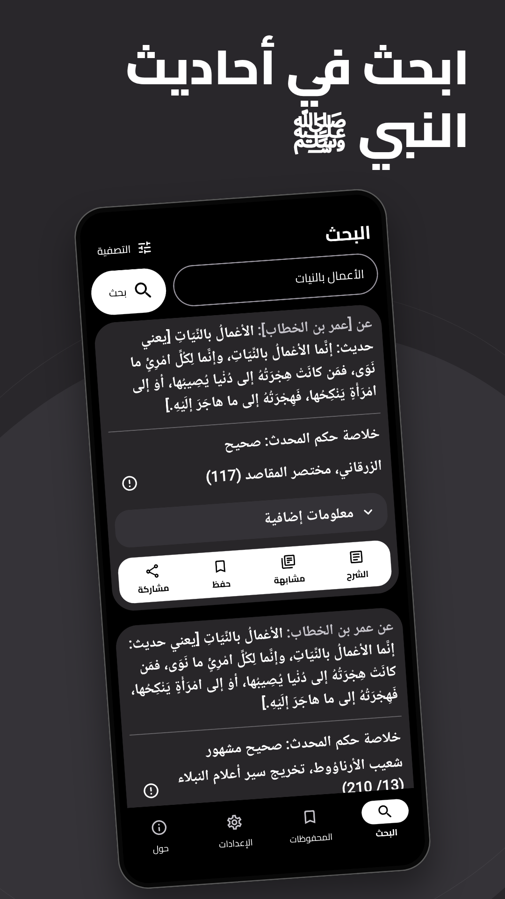
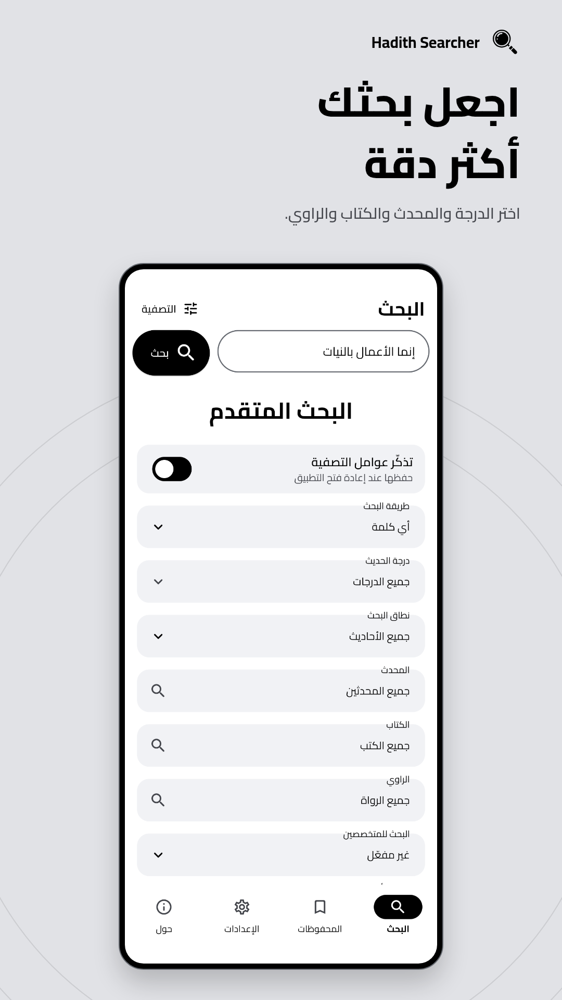
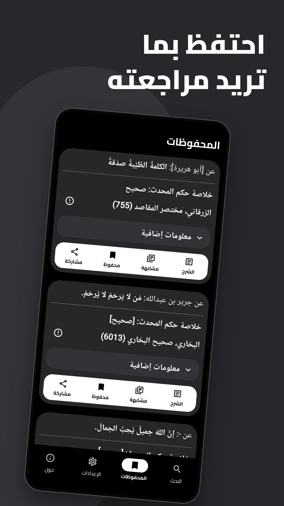
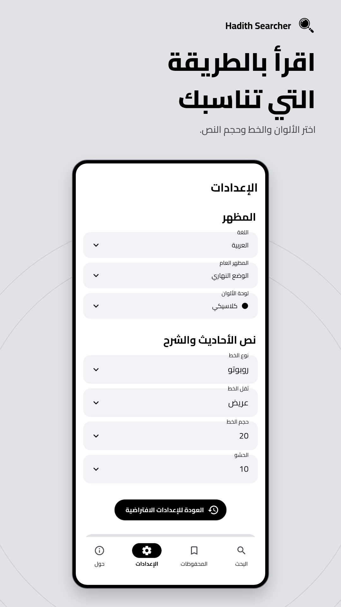
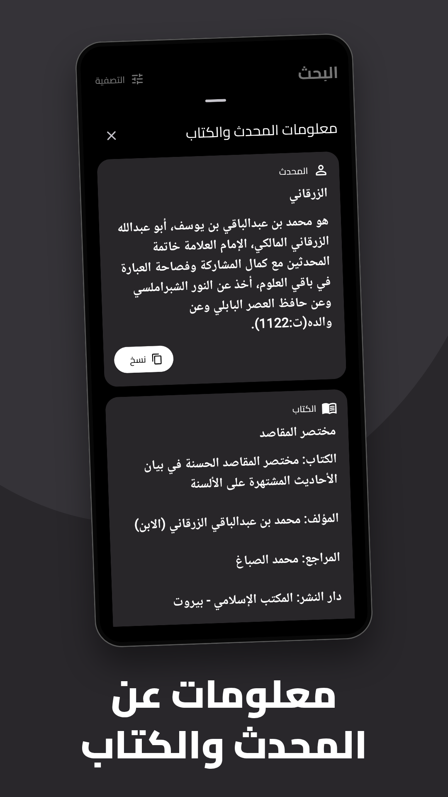

# Hadith Searcher

English | [العربية](README.md)

Search prophetic hadiths, read explanations, and check scholars' authenticity assessments.

## About the app

Hadith Searcher is a free, open-source Android app for finding and studying prophetic hadiths. It draws on Dorar al-Saniyyah for hadith texts, explanations, sources, and scholars' rulings.

## Features

- **Search.** Match any word, all words, or an exact phrase. Set the search scope and exclude words or phrases.
- **Hadith details.** See the narrator, source, scholar, a summary of the scholar's ruling, authenticity grade, source references, and original narrations.
- **Explanations.** Read explanations of hadiths and their meanings.
- **Similar hadiths.** Find hadiths similar to the one you're reading.
- **Advanced filters.** Narrow results by authenticity grade, scholar, book, or narrator.
- **Saved hadiths.** Save hadiths to read offline.
- **Appearance.** Choose the font and text size for hadiths and change the app colors.

## Screenshots

| Search | Advanced search |
|:---:|:---:|
|  |  |

| Original narrations | Saved hadiths |
|:---:|:---:|
|  |  |

| Appearance | Scholar and book details |
|:---:|:---:|
|  |  |

## Data sources

Hadiths and related information come from [Dorar al-Saniyyah](https://dorar.net/) through the [Dorar Hadith API](https://github.com/MAymanKH/dorar-hadith-api).

## Development

See [Developer documentation](docs/README.md) for setup, testing, architecture, and Android publishing.

## License

This project is free and open-source software licensed under the [GNU General Public License v3.0](LICENSE).
