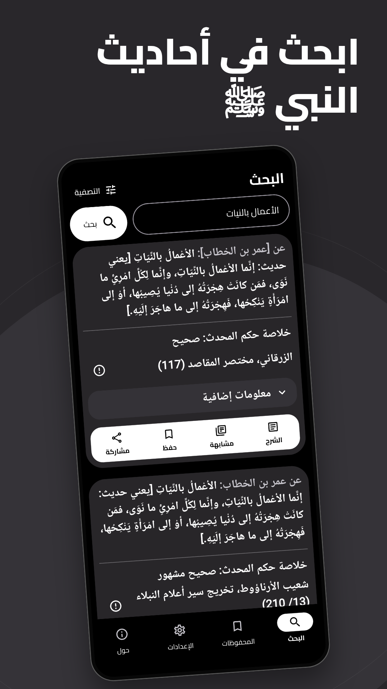
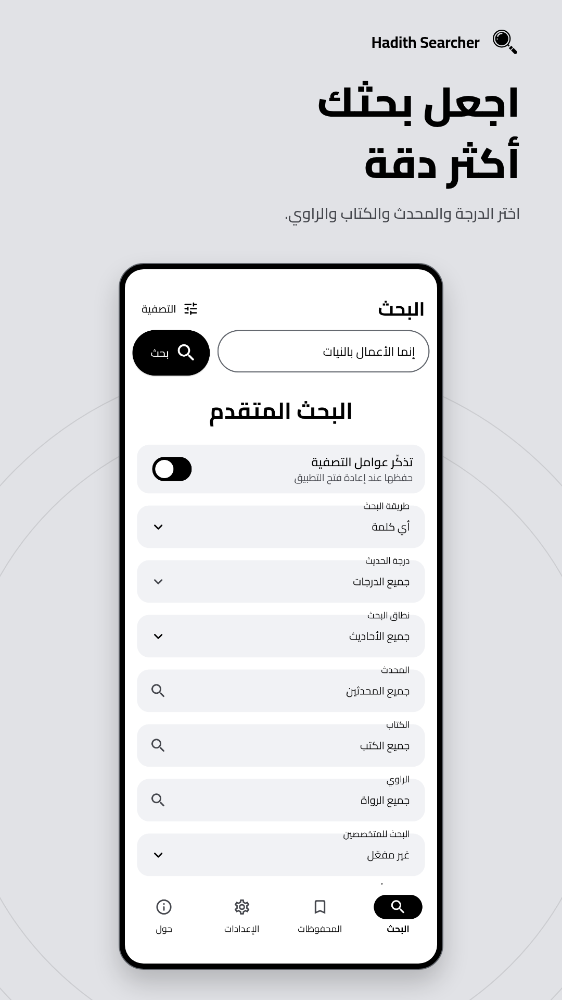
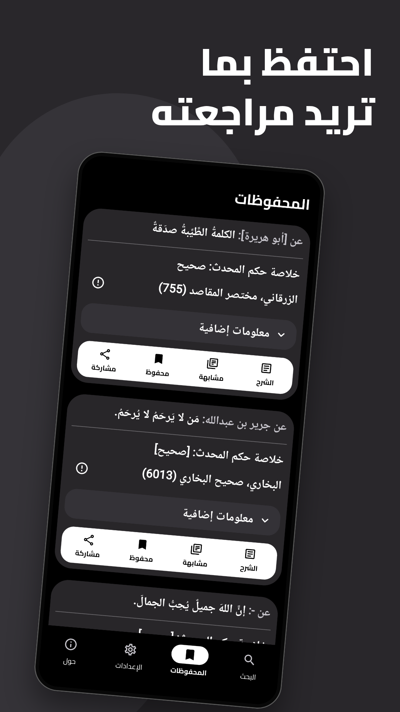
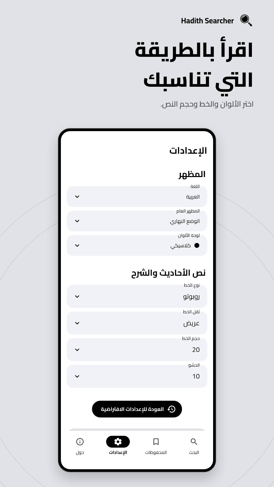

<div align="center">


# Hadith Searcher

English | [العربية](README.md)

Search prophetic hadiths, read explanations, and check scholars' authenticity assessments.

<a href="https://play.google.com/store/apps/details?id=com.moaymandev.hadithsearcher"></a>

</div>

## About the app

Hadith Searcher is a free, open-source Android app built with Flutter. It brings together hadith texts, explanations, sources, and scholars' assessments from Dorar al-Saniyyah.

## Features

- Search for any word, all words, or an exact phrase. Choose the search scope and exclude words or phrases.
- View the narrator, source, scholar, authenticity assessment, source references, and related original narrations.
- Read hadith explanations and find similar hadiths.
- Filter results by authenticity grade, scholar, book, or narrator.
- Save hadiths for offline reading.
- Customize hadith font size, font family, and app colors.

## Screenshots

<div align="center">

| Search | Advanced search |
|:---:|:---:|
|  |  |

| Original narrations | Saved hadiths |
|:---:|:---:|
|  |  |

| Appearance | Scholar and book details |
|:---:|:---:|
|  |  |

</div>

See the [store screenshot guide](store/screenshots/README.md) for screenshot designs and update instructions.

## Data sources

Hadiths and related information come from [Dorar al-Saniyyah](https://dorar.net/) through the [Dorar Hadith API](https://github.com/MAymanKH/dorar-hadith-api).

## Requirements

- Flutter `3.47.0` or later, with Dart `>=3.12.0 <4.0.0`, as specified in `pubspec.yaml`.
- Android SDK platform `37` and NDK `29.0.13113456`, as specified in `android/app/build.gradle.kts`.
- A JDK compatible with Gradle. You can use the JDK bundled with Android Studio.
- An Android emulator or physical device.
- Python 3 for the release and color generation scripts.

## Set up and run

### 1. Clone the repository

```bash
git clone https://github.com/MAymanKH/HadithSearcher.git
cd HadithSearcher
```

### 2. Configure services

The default API URL is in `lib/core/constants/app_config.dart`. Public Sentry and PostHog ingestion settings are in `lib/core/constants/telemetry_config.dart`. Builds do not require a `.env` file. Keep account administration tokens and private signing credentials out of source files.

To use another API server, pass `--dart-define=HADITH_API_BASE_URL=https://your-api.example` to the run or build command.

Play builds enable crash reports and usage analytics automatically. FOSS builds apply the onboarding choices after Continue; either option can be unchecked. See [Telemetry](docs/telemetry.md) for configuration, privacy details, and delivery checks.

### 3. Install dependencies

```bash
flutter doctor
flutter pub get
```

### 4. Run the app

```bash
flutter run --flavor foss
```

To run the Google Play flavor:

```bash
flutter run --flavor play
```

## Build Android releases

The two flavors are `play` and `foss`. The same FOSS APKs are distributed on GitHub and F-Droid. Their update dialog checks both sources and lets the user choose an available update. GitHub downloads select the device ABI. The FOSS flavor excludes Shorebird and the Google Play update library, and lets users choose telemetry on onboarding.

Set `version` in `pubspec.yaml` for each release. Reserve the last version-code digit for ABI variants: use base codes divisible by 10, such as `3.0.3+220`, then `3.0.4+230`. Play uses the base code. FOSS adds 1 for `arm64-v8a`, 2 for `armeabi-v7a`, or 3 for `x86_64`, producing codes 221, 222, and 223 for the first example. The FOSS updater compares release codes without the ABI digit.

Prepare `android/key.properties` with `storeFile`, `storePassword`, `keyAlias`, and `keyPassword`, and a local signing keystore. Relative keystore paths resolve from `android/app/`. Keep signing credentials out of version control. FOSS builds also require `android/local.properties` with `sdk.dir` and Android SDK Build Tools 35 or newer containing `apksigner` and `zipalign`.

The release script requires Python 3 and Flutter. Play releases require Shorebird and a prior `shorebird login`, and use Flutter `3.47.7` through Shorebird.

| Command | Result |
| --- | --- |
| `./scripts/release.py play` | Build a Google Play AAB and register it with Shorebird. |
| `./scripts/release.py foss` | Build and sign three ABI APKs for GitHub and F-Droid. |
| `./scripts/release.py all` | Build FOSS and Google Play releases in sequence. |
| `./scripts/release.py play --dry-run` | Build the Play bundle without registering it with Shorebird. |
| `./scripts/release.py patch-play` | Send a Dart update for the Play release in `pubspec.yaml`. |

Outputs are saved in `build/releases/play/` and `build/releases/foss/`. The script does not upload files. FOSS filenames include the actual APK version code and ABI, for example `HadithSearcher-3.0.3+221-foss-arm64-v8a.apk`. Publish all three APKs on the GitHub release tagged `3.0.3`. F-Droid uses those same signed assets as reference binaries and publishes them after reproducing the build and verifying the pinned signing certificate.

For unsigned rebuilds, run:

```bash
python3 scripts/build_foss_unsigned.py
# Build only one architecture:
python3 scripts/build_foss_unsigned.py --abi arm64-v8a
```

Outputs are `build/app/outputs/flutter-apk/app-<abi>-foss-release.apk`. Both the release script and F-Droid recipe use this builder. It builds in `/var/tmp/hadithsearcher-foss` to keep generated Dart URIs stable, disables the JNI native library's path-dependent build ID, and removes the workspace afterward. Keep several GiB free and run one FOSS build at a time. If a killed process leaves the workspace behind, remove it after confirming no build is running. Signing preserves ZIP alignment and uses v2/v3 signatures without legacy v1 signing.

Use the recipe's Flutter revision, source commit, and Android toolchain for reference APKs and rebuilds. F-Droid fetches Flutter through its srclib mechanism; the app repository has no SDK submodule. Set `FLUTTER_BIN=/path/to/flutter` for local builds, or pass `--flutter` to the unsigned builder. Use a detached SDK checkout at the pinned revision because Flutter embeds channel metadata.

Before updating the recipe, verify each signed APK against a fresh unsigned build:

```bash
python3 -m venv /tmp/hadith-repro-check
/tmp/hadith-repro-check/bin/pip install apksigcopier
/tmp/hadith-repro-check/bin/python scripts/verify_fdroid_reproducibility.py \
  build/releases/foss/HadithSearcher-3.0.3+221-foss-arm64-v8a.apk \
  build/app/outputs/flutter-apk/app-arm64-v8a-foss-release.apk \
  --apksigner "$ANDROID_HOME/build-tools/37.0.0/apksigner"
```

The check copies the upstream signature onto the rebuild, verifies it, and checks the certificate against the recipe. Local verification does not replace F-Droid's build-server verification. Pin the source commit matching the published APKs. Each ABI has its own recipe build and binary URL. `VercodeOperation` adds the ABI suffix to the base code when checking for updates. Format submission metadata with the fdroidserver and YAML versions used by F-Droid CI.

Play builds use an isolated workspace under `build/hadith-play-*`. Android builds use one Gradle worker and compile Kotlin in the Gradle JVM with a 2 GiB heap limit. Gradle exits after each build. Keep several GiB free; if a daemon disappears, check the system journal for memory pressure. If Play fails after FOSS finishes, retry with `./scripts/release.py play`.

Switching between Play and FOSS requires the same app signing certificate and an equal or higher installed `versionCode`. Play's app signing key must match the local key, even when its upload key differs. Within a release, a FOSS ABI code is higher than Play's base code, so moving back to Play requires a newer release. GitHub and F-Droid distribute identical APKs for each ABI.

## Verify the project

Run static analysis, unit and widget tests, and the release script tests:

```bash
flutter analyze
flutter test test
python3 -m unittest discover -s test -p release_update_channel_test.py
```

To check search and source details against the live API:

```bash
flutter test test/hadith_details_live_test.dart --dart-define=VERIFY_LIVE_DETAILS=true
flutter test test/filter_catalog_live_test.dart --dart-define=VERIFY_LIVE_FILTERS=true
```

The following integration test starts a local fixture server and clears app preferences on the emulator. Use a disposable emulator and replace `emulator-5554` with its device ID. Screenshots are saved in `build/api-capabilities`.

```bash
flutter drive --driver=test_driver/api_capabilities.dart \
  --target=integration_test/api_capabilities_test.dart \
  -d emulator-5554 --flavor foss \
  --dart-define=HADITH_API_BASE_URL=http://127.0.0.1:8717 \
  --dart-define=API_SCREENSHOTS=true
```

## Development guides

- [Interface localization and text](lib/l10n/README.md)
- [Change colors and generate theme files](docs/change-colors.md)
- [Telemetry and privacy](docs/telemetry.md)
- [Store screenshots](store/screenshots/README.md)

## License

This project is free and open-source software licensed under the [GNU General Public License v3.0](LICENSE).
