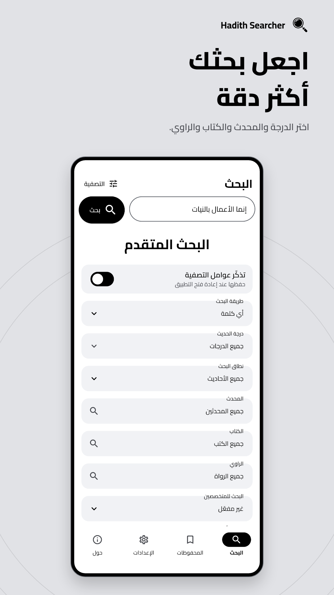
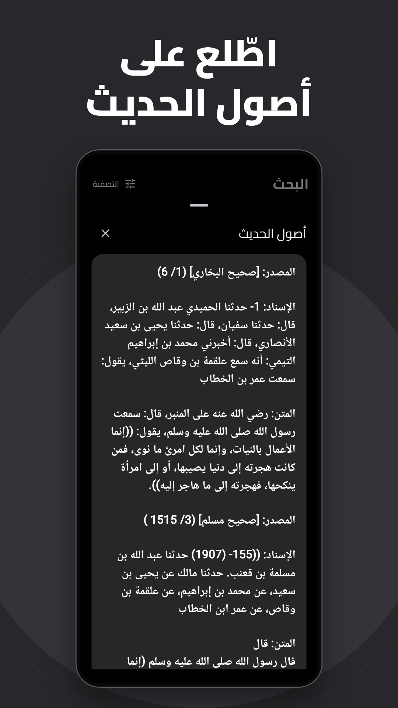
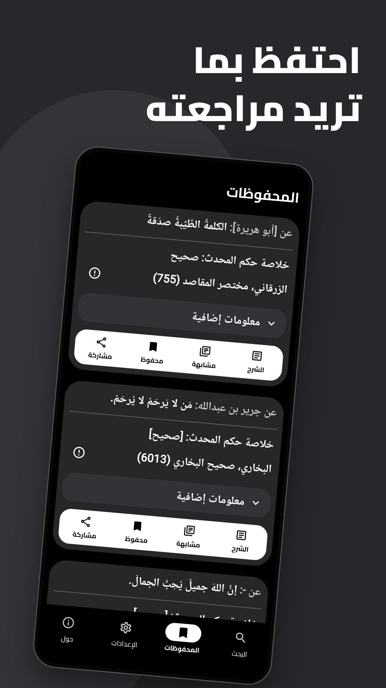
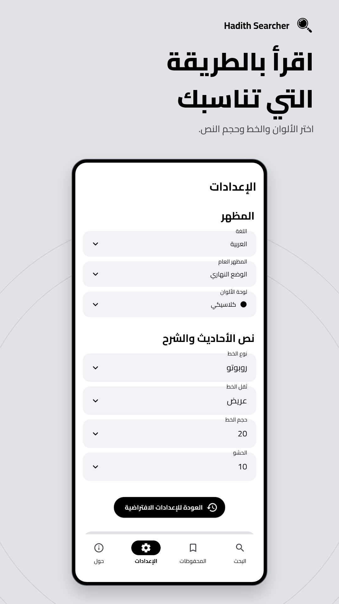

# Hadith Searcher

[English](README.en.md) | العربية

تطبيق للبحث في الأحاديث النبوية والاطّلاع على شروحها وأحكام المحدثين عليها

## حول التطبيق

تطبيق Hadith Searcher هو تطبيق مجاني ومفتوح المصدر للبحث في الأحاديث النبوية والاطّلاع على شروحها ومصادرها وأحكام المحدثين عليها. يعتمد على محتوى موقع الدرر السنية، ويجمع معلومات الحديث في مكان واحد لتيسير قراءته ودراسته.

## المميزات

- **البحث** - البحث بأي كلمة أو بجميع الكلمات أو بعبارة مطابقة، مع اختيار نطاق البحث واستبعاد كلمات أو جملة
- **بيانات الحديث** - عرض الراوي والمصدر والمحدث وخلاصة حكم المحدث والتخريج وأصول الحديث
- **الشروحات** - الاطلاع على شروحات وتفاسير الأحاديث
- **الأحاديث المشابهة** - البحث عن أحاديث مشابهة للحديث المعروض
- **تصفية متقدمة** - اختيار درجات أو محدثين أو كتب أو رواة في البحث من ضمن آلاف الاختيارات
- **المحفوظات** - حفظ الأحاديث للقراءة بدون اتصال بالإنترنت
- **تخصيص المظهر** - التحكم في حجم ونوع خط الأحاديث ودعم العديد من الألوان للتطبيق

## صور من التطبيق

| البحث | البحث المتقدم |
|:---:|:---:|
|  |  |

| أصول الحديث | المحفوظات |
|:---:|:---:|
|  |  |

| تخصيص المظهر | معلومات المحدث والكتاب |
|:---:|:---:|
|  |  |

## مصادر البيانات

جميع الأحاديث والمعلومات مأخوذة من موقع [الدرر السنية](https://dorar.net/) باستخدام [Dorar Hadith API](https://github.com/MAymanKH/dorar-hadith-api).

## التطوير

راجع [وثائق التطوير](docs/README.md) لإعداد بيئة العمل وتشغيل الاختبارات والاطّلاع على بنية التطبيق وخطوات النشر.

## الترخيص

هذا المشروع مرخص بموجب [رخصة GNU العمومية الإصدار 3](LICENSE) - برنامج حر ومفتوح المصدر.

